# List of Coding Club STEM Kits

Here are the STEM kits our Coding Club uses or recommends, grouped by category, with a rough parts cost and a link to each kit's full guide.

!!! note "About the costs"
    Costs are approximate single-kit parts prices taken from each kit's own page or this textbook, and they do not include shipping. Buying in bulk usually lowers the price. "TBD" means no total cost has been published yet.

## Recommended Starter Kits

Start here. These two low-cost kits, each about $20 or less, are the best first projects for a new club.

### Moving Rainbow Base Kit

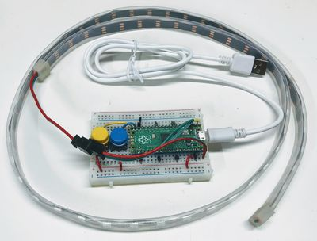{ width="300" }

The club's most popular kit: a Raspberry Pi Pico driving a 30-pixel NeoPixel LED strip, with two push buttons to change patterns, a small breadboard, jumper wires, and a USB cable. Students change the colors and animations purely in code (Chapter 19).

**Source:** Moving Rainbow  
**Approximate parts cost:** about $15 (Pico $4, 30-pixel strip $6, breadboard $2, jumper wires $1, USB cable $2)  
**Link:** [https://dmccreary.github.io/moving-rainbow/kits/moving-rainbow-base/](https://dmccreary.github.io/moving-rainbow/kits/moving-rainbow-base/)

### Chrono Smart Clock Kit

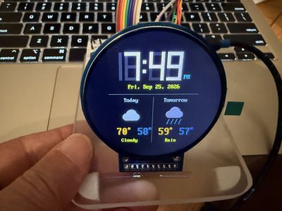{ width="300" }

A round-screen smart clock on a Pico W that sets its own time from the internet and shows the weather, a stopwatch, and a timer. It has 13 labs, needs no soldering, and is for ages 10 and up.

**Source:** Clocks and Watches  
**Approximate parts cost:** under $20  
**Link:** [https://dmccreary.github.io/clocks-and-watches/kits/sw-gc9b72/](https://dmccreary.github.io/clocks-and-watches/kits/sw-gc9b72/)

## Lights and NeoPixels

Programmable LED strips, matrices, and nightlights where students change the colors and patterns in code.

### Tilt-a-Rainbow Kit

{ width="300" }

A 16x16 NeoPixel matrix (256 pixels) with a LIS3DH accelerometer, so tilting the board rolls the lights around. It has two buttons to change modes.

**Source:** Moving Rainbow  
**Approximate parts cost:** $25.50  
**Link:** [https://dmccreary.github.io/moving-rainbow/kits/16x16-matrix-accel/](https://dmccreary.github.io/moving-rainbow/kits/16x16-matrix-accel/)

### Tilt-a-Rainbow Mini Kit

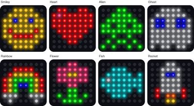{ width="300" }

The little sibling of the Tilt-a-Rainbow Kit, using an 8x8 matrix with the same Pico, sensor, and buttons, plus five drawing labs.

**Source:** Moving Rainbow  
**Approximate parts cost:** $19.50  
**Link:** Not yet published (the page is in the moving-rainbow repo at docs/kits/8x8-matrix-accel)

### 8x8 NeoPixel Matrix Project

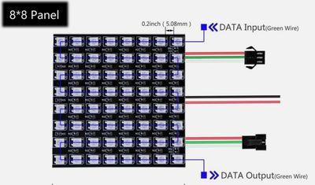{ width="300" }

An 8x8 panel of 64 RGB pixels, programmed with the NeoPixel library built into MicroPython.

**Source:** Moving Rainbow  
**Approximate parts cost:** about $12 (matrix panel)  
**Link:** [https://dmccreary.github.io/moving-rainbow/kits/8x8-neopixel-matrix/](https://dmccreary.github.io/moving-rainbow/kits/8x8-neopixel-matrix/)

### Rotary Spinner Box

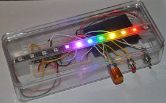{ width="300" }

A hand-held light-up box with a 12-LED strip that students control with a spinning knob (rotary encoder) and two buttons.

**Source:** Moving Rainbow  
**Approximate parts cost:** about $15  
**Link:** [https://dmccreary.github.io/moving-rainbow/kits/rotary-spinner-box/](https://dmccreary.github.io/moving-rainbow/kits/rotary-spinner-box/)

### Name Sign Night Light

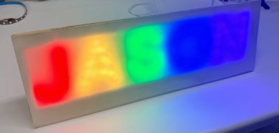{ width="300" }

A NeoPixel sign spelling a name (the example is "JASON"), with a photo sensor on the back. When the room goes dark it stays lit for 10 minutes, then fades; buttons change the pattern.

**Source:** Moving Rainbow  
**Approximate parts cost:** under $16  
**Link:** [https://dmccreary.github.io/moving-rainbow/kits/name-sign-night-light/](https://dmccreary.github.io/moving-rainbow/kits/name-sign-night-light/)

### Digital Nightlight

{ width="300" }

A Pico on a breadboard with a button, two potentiometers, a power switch, and a photoresistor, so the LED strip shows a pattern only when the room is dark.

**Source:** Moving Rainbow  
**Cost:** TBD  
**Link:** [https://dmccreary.github.io/moving-rainbow/kits/digital-nightlight/](https://dmccreary.github.io/moving-rainbow/kits/digital-nightlight/)

### Analog Nightlight

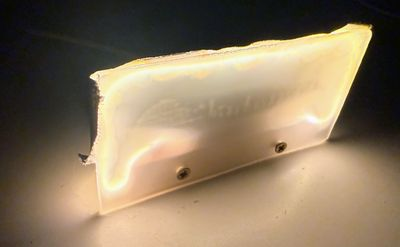{ width="300" }

A no-code nightlight: an LED noodle switched by a photoresistor and a 2N2222 transistor on perfboard, powered by a USB wall adapter.

**Source:** Moving Rainbow  
**Approximate parts cost:** about $4–$6 (sum of the listed parts)  
**Link:** [https://dmccreary.github.io/moving-rainbow/kits/analog-nightlight/](https://dmccreary.github.io/moving-rainbow/kits/analog-nightlight/)

### Nightlight Circuit Design

A nightlight circuit using a light-dependent resistor as the sensor, a 2N2222 transistor as the switch, and two potentiometers for adjustment.

**Source:** Moving Rainbow  
**Cost:** TBD  
**Link:** [https://dmccreary.github.io/moving-rainbow/kits/nightlight/](https://dmccreary.github.io/moving-rainbow/kits/nightlight/)

### LED Noodle Nightlight

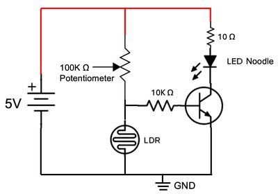{ width="300" }

A simple, low-cost nightlight that turns on when the room gets dark, using a bendable LED noodle instead of a NeoPixel strip.

**Source:** Moving Rainbow  
**Cost:** TBD  
**Link:** [https://dmccreary.github.io/moving-rainbow/kits/led-noodle-nightlight/](https://dmccreary.github.io/moving-rainbow/kits/led-noodle-nightlight/)

### Solar-Powered Nightlight

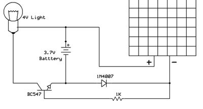{ width="300" }

A nightlight that charges itself in daylight and lights up on its own at night, with no code and no power switch.

**Source:** Moving Rainbow  
**Cost:** TBD  
**Link:** [https://dmccreary.github.io/moving-rainbow/kits/solar-powered-led-nightlight/](https://dmccreary.github.io/moving-rainbow/kits/solar-powered-led-nightlight/)

### LED Dimmer

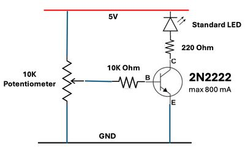{ width="300" }

A transistor circuit that dims an LED with a potentiometer, using a 5 V supply, a 2N2222 transistor, and resistors.

**Source:** Moving Rainbow  
**Cost:** TBD  
**Link:** [https://dmccreary.github.io/moving-rainbow/kits/led-dimmer/](https://dmccreary.github.io/moving-rainbow/kits/led-dimmer/)

### LED Candle Kit

A NeoPixel ring that simulates a flickering candle, with a Pico, a breadboard, and either 3 AA batteries or a USB wall adapter.

**Source:** Moving Rainbow  
**Approximate parts cost:** about $10  
**Link:** [https://dmccreary.github.io/moving-rainbow/kits/led-candle/](https://dmccreary.github.io/moving-rainbow/kits/led-candle/)

### Cylon Pumpkin

{ width="300" }

A craft foam pumpkin with a dense 144-pixel-per-meter NeoPixel strip that shows a scanning "Cylon eye" effect.

**Source:** Moving Rainbow  
**Approximate parts cost:** about $24 (pumpkin $10, LED strip $10, Pico $3.99)  
**Link:** [https://dmccreary.github.io/moving-rainbow/kits/cylon-pumpkin/](https://dmccreary.github.io/moving-rainbow/kits/cylon-pumpkin/)

### Halloween NeoPixel Patterns

A set of Halloween party patterns for the standard NeoPixel strip and buttons, power-limited for safety, that cycles through patterns automatically.

**Source:** Moving Rainbow  
**Cost:** TBD (uses the Moving Rainbow kit)  
**Link:** [https://dmccreary.github.io/moving-rainbow/kits/halloween/](https://dmccreary.github.io/moving-rainbow/kits/halloween/)

### Holiday Hats

A favorite student project: a foam-core hat lit with the standard Moving Rainbow kit. Students reuse the same hat all year by changing the color pattern.

**Source:** Moving Rainbow  
**Cost:** TBD (Moving Rainbow kit plus foam-core board)  
**Link:** [https://dmccreary.github.io/moving-rainbow/kits/holiday-hats/](https://dmccreary.github.io/moving-rainbow/kits/holiday-hats/)

### Jake's Fire

{ width="300" }

A small, color-changing tabletop campfire made from programmable RGB LEDs, built from a student's request.

**Source:** Moving Rainbow  
**Cost:** TBD  
**Link:** [https://dmccreary.github.io/moving-rainbow/kits/jakes-fire/](https://dmccreary.github.io/moving-rainbow/kits/jakes-fire/)

### BookStore Sign

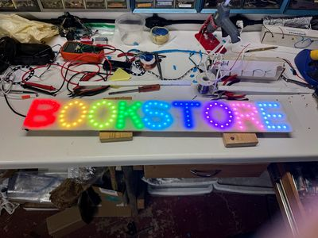{ width="300" }

A 134-pixel NeoPixel sign that spells out the word "Bookstore."

**Source:** Moving Rainbow  
**Cost:** TBD  
**Link:** [https://dmccreary.github.io/moving-rainbow/kits/bookstore-sign/](https://dmccreary.github.io/moving-rainbow/kits/bookstore-sign/)

### NeoPixel Kit

{ width="300" }

A low-cost kit used in many of Dan's classes: a Pico, a half-size breadboard, and a WS2812B LED strip (8 to 60 pixels).

**Source:** Learning MicroPython  
**Approximate parts cost:** under $10  
**Link:** [https://dmccreary.github.io/learning-micropython/kits/neopixel/](https://dmccreary.github.io/learning-micropython/kits/neopixel/)

### NeoPixel Two Button Kit

A NeoPixel strip and two buttons on a Pico, used for hackathons and events like a Halloween costume contest.

**Source:** Learning MicroPython  
**Approximate parts cost:** about $10  
**Link:** [https://dmccreary.github.io/learning-micropython/kits/03-neopixel-strip-two-buttons/](https://dmccreary.github.io/learning-micropython/kits/03-neopixel-strip-two-buttons/)

### Rotary NeoPixel

A rotary encoder and a button control a NeoPixel strip: spin to move the pixel, press the knob to change the color, and press the button to change the pattern.

**Source:** Learning MicroPython  
**Cost:** TBD  
**Link:** [https://dmccreary.github.io/learning-micropython/kits/03-rotary-neopixel/](https://dmccreary.github.io/learning-micropython/kits/03-rotary-neopixel/)

### Raspberry Pi RGB Box

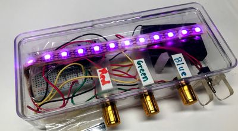{ width="300" }

Three knobs, one each for red, green, and blue, mix the color of a NeoPixel strip inside a clear project box.

**Source:** Learning MicroPython  
**Approximate parts cost:** about $15 (under $10 when parts are bought in batches of ten)  
**Link:** [https://dmccreary.github.io/learning-micropython/kits/rgb-box/](https://dmccreary.github.io/learning-micropython/kits/rgb-box/)

### Larson Scanner Pumpkin

{ width="300" }

The Knight Rider/Cylon "scanner" light effect on a 144-pixel-per-meter LED strip glued into a craft pumpkin.

**Source:** Learning MicroPython  
**Approximate parts cost:** about $24 plus a battery pack (pumpkin $10, Pico $4, breadboard $2, LED strip $8)  
**Link:** [https://dmccreary.github.io/learning-micropython/kits/larson-scanner/01-intro/](https://dmccreary.github.io/learning-micropython/kits/larson-scanner/01-intro/)

### Pulse Width Modulation Kit

A 9th-grade lesson kit that teaches PWM by dimming an LED with a potentiometer, with an OLED for output.

**Source:** Learning MicroPython  
**Approximate parts cost:** about $19 (sum of the listed parts: Pico $4, breadboard $1.75, potentiometer $0.50, LED $0.05, OLED $13)  
**Link:** [https://dmccreary.github.io/learning-micropython/kits/pwm/](https://dmccreary.github.io/learning-micropython/kits/pwm/)

## Clocks and Watches

Clocks, stopwatches, and smartwatch faces built on many kinds of displays, from tiny OLEDs to round color screens.

### Study Buddy Kit

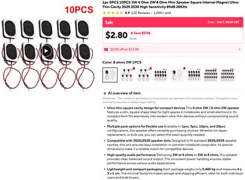{ width="300" }

The smartwatch-display clock kit with a speaker added and study-focused modes, with new modes and quiz decks downloaded over WiFi.

**Source:** Clocks and Watches  
**Cost:** TBD  
**Link:** [https://dmccreary.github.io/clocks-and-watches/kits/study-buddy/](https://dmccreary.github.io/clocks-and-watches/kits/study-buddy/)

### Knob Clock Kit

{ width="300" }

A color-screen clock with one turn-and-press knob and one button. Students start by blinking a light and finish with five clock faces.

**Source:** Clocks and Watches  
**Cost:** TBD (the display board with knob and button was $5.53; you also need a Pico 2 W, a breadboard, wires, and a USB cable)  
**Link:** [https://dmccreary.github.io/clocks-and-watches/kits/rect-tft-display/](https://dmccreary.github.io/clocks-and-watches/kits/rect-tft-display/)

### Large OLED Kit

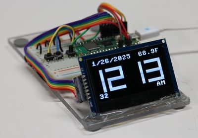{ width="300" }

One of the most versatile kits: a bright 128x64 SSD1306 OLED with a Pico W and a DS3231 real-time clock that is accurate to about 2 seconds per month.

**Source:** Clocks and Watches  
**Cost:** TBD  
**Link:** [https://dmccreary.github.io/clocks-and-watches/kits/oled-large/](https://dmccreary.github.io/clocks-and-watches/kits/oled-large/)

### Tiny SSD1306 I2C OLED Clock

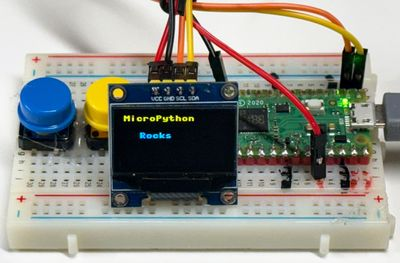{ width="300" }

An ideal starter clock using a small 1" OLED with a simple four-wire I2C connection.

**Source:** Clocks and Watches  
**Cost:** TBD (the display is $3–$4)  
**Link:** [https://dmccreary.github.io/clocks-and-watches/kits/ssd1306-i2c/](https://dmccreary.github.io/clocks-and-watches/kits/ssd1306-i2c/)

### SH1106 OLED Driver Kit

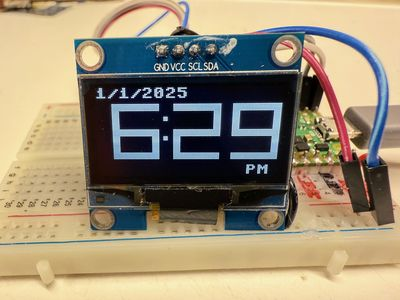{ width="300" }

A clock that uses the larger 1.3" SH1106 OLED over I2C.

**Source:** Clocks and Watches  
**Cost:** TBD  
**Link:** [https://dmccreary.github.io/clocks-and-watches/kits/sh1106/](https://dmccreary.github.io/clocks-and-watches/kits/sh1106/)

### ST7735 Digital Clock

{ width="300" }

A low-cost 1.8" 160x128 color LCD clock, an ideal starter color display for clock kits.

**Source:** Clocks and Watches  
**Approximate parts cost:** under $10 (the display is about $3.50)  
**Link:** [https://dmccreary.github.io/clocks-and-watches/kits/st7735/](https://dmccreary.github.io/clocks-and-watches/kits/st7735/)

### ILI9341 Display Kit

{ width="300" }

A 240x320 color TFT that can draw smooth analog clock faces.

**Source:** Clocks and Watches  
**Cost:** TBD (the display board is about $9)  
**Link:** [https://dmccreary.github.io/clocks-and-watches/kits/ili9341/](https://dmccreary.github.io/clocks-and-watches/kits/ili9341/)

### GC9A01 Display Kit

{ width="300" }

A 240x240 round color display connected over SPI, used for watch faces.

**Source:** Clocks and Watches  
**Cost:** TBD  
**Link:** [https://dmccreary.github.io/clocks-and-watches/kits/gc9a01/](https://dmccreary.github.io/clocks-and-watches/kits/gc9a01/)

### LILYGO T-Display RP2040 Kit

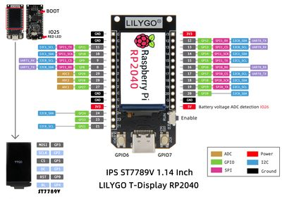{ width="300" }

An RP2040 board with a built-in 1.14" 240x135 color LCD (ST7789V) and a high-quality, flicker-free driver.

**Source:** Clocks and Watches  
**Approximate parts cost:** about $11 (board, plus about $3 shipping)  
**Link:** [https://dmccreary.github.io/clocks-and-watches/kits/lilygo/](https://dmccreary.github.io/clocks-and-watches/kits/lilygo/)

### Waveshare RP2040 LCD

{ width="300" }

A development board with a 1.28" round IPS LCD, USB-C, a LiPo battery connector, and a built-in accelerometer and gyroscope.

**Source:** Clocks and Watches  
**Approximate parts cost:** about $18  
**Link:** [https://dmccreary.github.io/clocks-and-watches/kits/waveshare-lcd/](https://dmccreary.github.io/clocks-and-watches/kits/waveshare-lcd/)

### Portable Smartwatch Kits

Options for making the breadboard smartwatch kits truly wearable. The best fit is the Waveshare ESP32-S3-Touch-LCD-1.28 with onboard LiPo charging.

**Source:** Clocks and Watches  
**Approximate parts cost:** about $15–$20 plus a battery (recommended option)  
**Link:** [https://dmccreary.github.io/clocks-and-watches/kits/portable-watch-kits/](https://dmccreary.github.io/clocks-and-watches/kits/portable-watch-kits/)

### Character LCD Clock

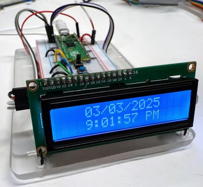{ width="300" }

A 16x2 LCD1602 character display with a real-time clock that shows the date, time, and temperature.

**Source:** Clocks and Watches  
**Cost:** TBD (the display is about $5)  
**Link:** [https://dmccreary.github.io/clocks-and-watches/kits/char-lcd-clock/](https://dmccreary.github.io/clocks-and-watches/kits/char-lcd-clock/)

### LED Display Clock

{ width="300" }

A clock using the TM1637 4-digit LED display module.

**Source:** Clocks and Watches  
**Approximate parts cost:** under $10  
**Link:** [https://dmccreary.github.io/clocks-and-watches/kits/led-displays/](https://dmccreary.github.io/clocks-and-watches/kits/led-displays/)

### TM1637 LED Display

{ width="300" }

A very popular, low-cost 4-digit 7-segment module for clocks, counters, and other number displays.

**Source:** Clocks and Watches  
**Cost:** TBD (the display is about 30 cents in bulk)  
**Link:** [https://dmccreary.github.io/clocks-and-watches/kits/tm1637/](https://dmccreary.github.io/clocks-and-watches/kits/tm1637/)

### TM1650 LED Clock

{ width="300" }

A four-digit seven-segment clock driven by the TM1650 LED driver chip.

**Source:** Clocks and Watches  
**Cost:** TBD  
**Link:** [https://dmccreary.github.io/clocks-and-watches/kits/tm1650-led-clock/](https://dmccreary.github.io/clocks-and-watches/kits/tm1650-led-clock/)

### MAX7219 Clocks

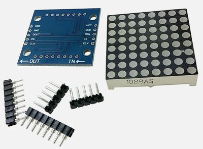{ width="300" }

Clocks built on the MAX7219 chip, which drives a row of seven-segment displays (or an LED matrix) over one serial interface.

**Source:** Clocks and Watches  
**Cost:** TBD  
**Link:** [https://dmccreary.github.io/clocks-and-watches/kits/max7219/](https://dmccreary.github.io/clocks-and-watches/kits/max7219/)

### 74HC595 Shift Register Clock

A seven-segment clock driven through 74HC595 shift registers using only a few Pico pins.

**Source:** Clocks and Watches  
**Cost:** TBD  
**Link:** [https://dmccreary.github.io/clocks-and-watches/kits/shift-register-clock/](https://dmccreary.github.io/clocks-and-watches/kits/shift-register-clock/)

### NeoPixel LED Strip Clock Kits

{ width="300" }

Three art clocks, including a binary clock, built from a strip of low-cost WS2812B NeoPixels.

**Source:** Clocks and Watches  
**Cost:** TBD (NeoPixel strip is about $5 per meter)  
**Link:** [https://dmccreary.github.io/clocks-and-watches/kits/neopixel/](https://dmccreary.github.io/clocks-and-watches/kits/neopixel/)

### Stopwatch

{ width="300" }

A two-button stopwatch (Start/Stop and Reset) on an OLED display.

**Source:** Clocks and Watches  
**Cost:** TBD  
**Link:** [https://dmccreary.github.io/clocks-and-watches/kits/stopwatch/](https://dmccreary.github.io/clocks-and-watches/kits/stopwatch/)

### Alarm Clocks

Clock projects that add alarm-setting features and buttons, which take careful design.

**Source:** Clocks and Watches  
**Cost:** TBD  
**Link:** [https://dmccreary.github.io/clocks-and-watches/kits/alarm-clock/](https://dmccreary.github.io/clocks-and-watches/kits/alarm-clock/)

### OLED Wireless Weather Kit

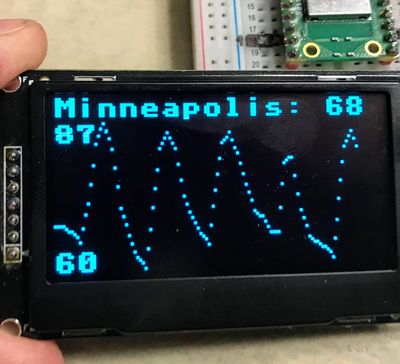{ width="300" }

An OLED display on a networked Pico that shows the time and weather fetched over WiFi.

**Source:** Clocks and Watches  
**Cost:** TBD  
**Link:** [https://dmccreary.github.io/clocks-and-watches/kits/oled-wireless/](https://dmccreary.github.io/clocks-and-watches/kits/oled-wireless/)

### E-Ink Displays

Notes on low-cost e-paper displays with good MicroPython drivers, such as the small Waveshare modules and LILYGO T5 boards.

**Source:** Clocks and Watches  
**Cost:** TBD (displays about $15–$25)  
**Link:** [https://dmccreary.github.io/clocks-and-watches/kits/e-paper/](https://dmccreary.github.io/clocks-and-watches/kits/e-paper/)

### Waveshare E-Paper Display

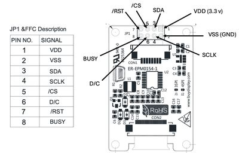{ width="300" }

A 1.54" 152x152 black-and-white e-paper module that is readable in sunlight.

**Source:** Clocks and Watches  
**Cost:** TBD  
**Link:** [https://dmccreary.github.io/clocks-and-watches/kits/waveshare-e-paper/](https://dmccreary.github.io/clocks-and-watches/kits/waveshare-e-paper/)

### 1.2" Smartwatch Kit

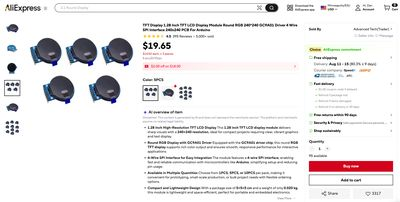{ width="300" }

The OLED faces labs ported to a 240x240 round color GC9A01 display, the same panel used in cheap smartwatches.

**Source:** Robot Faces  
**Approximate parts cost:** under $10 (display and Pico together)  
**Link:** [https://dmccreary.github.io/robot-faces/kits/smartwatch/](https://dmccreary.github.io/robot-faces/kits/smartwatch/)

### 2.1" Smartwatch Kit

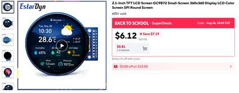{ width="300" }

The same labs on a bigger 360x360 round GC9B72 display. A copy of this kit is also the demo kit at The Thinking Spot.

**Source:** Robot Faces  
**Cost:** TBD (the display was $6.12 on AliExpress)  
**Link:** [https://dmccreary.github.io/robot-faces/kits/sw-gc9b72/](https://dmccreary.github.io/robot-faces/kits/sw-gc9b72/) (Thinking Spot copy: [https://dmccreary.github.io/thinking-spot-demos/kits/sw-gc9b72/](https://dmccreary.github.io/thinking-spot-demos/kits/sw-gc9b72/))

## Fun with Sensors

Kits that sense light, sound, temperature, distance, motion, direction, and RFID cards, and show what they find.

### Tone Generator

A Pico, a potentiometer, a speaker, and a 4-digit 7-segment display make adjustable tones.

**Source:** Learning MicroPython  
**Approximate parts cost:** under $10  
**Link:** [https://dmccreary.github.io/learning-micropython/kits/tone-generator/](https://dmccreary.github.io/learning-micropython/kits/tone-generator/)

### Distance Sensor Box

A project box pairing a distance sensor with a display. It supports three kinds of distance sensor (binary IR, ultrasonic, and time-of-flight) and two kinds of display.

**Source:** Learning MicroPython  
**Cost:** TBD  
**Link:** [https://dmccreary.github.io/learning-micropython/kits/distance-sensor/](https://dmccreary.github.io/learning-micropython/kits/distance-sensor/)

### MAX4466 Microphone Kit

A low-cost MAX4466 microphone with a built-in amplifier, wired straight to the Pico's ADC to show sound as an Audacity-style waveform.

**Source:** Learning MicroPython  
**Cost:** TBD  
**Link:** [https://dmccreary.github.io/learning-micropython/kits/microphone-max4466/](https://dmccreary.github.io/learning-micropython/kits/microphone-max4466/)

### Spectrum Analyzer Kit

Reads a microphone through the ADC, runs an FFT, and shows a live frequency spectrum on an OLED. It has since grown into its own book.

**Source:** Learning MicroPython  
**Cost:** TBD  
**Link:** [https://dmccreary.github.io/spectrum-analyzer/](https://dmccreary.github.io/spectrum-analyzer/)

### SHT40 Temperature and Humidity

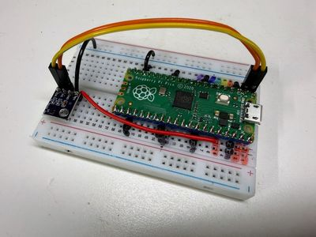{ width="300" }

A beginner lab that reads air temperature and humidity from the tiny SHT40 I2C sensor and shows both numbers changing live.

**Source:** Learning MicroPython  
**Cost:** TBD (the sensor is about $1.65 on eBay)  
**Link:** [https://dmccreary.github.io/learning-micropython/kits/sht40-temp/](https://dmccreary.github.io/learning-micropython/kits/sht40-temp/)

### Mood Ring Thermometer

{ width="300" }

The SHT40 sensor paired with a low-cost round GC9A01 "smartwatch" display that changes color with the temperature.

**Source:** Learning MicroPython  
**Approximate parts cost:** about $11 (sum of the listed parts: Pico $4, SHT40 $1.65, GC9A01 display $5)  
**Link:** [https://dmccreary.github.io/learning-micropython/kits/sht40-temp-display/](https://dmccreary.github.io/learning-micropython/kits/sht40-temp-display/)

### RC522 RFID Kit

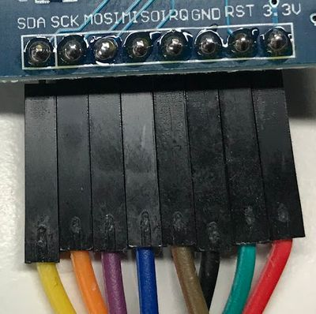{ width="300" }

A popular 13.56 MHz RFID card reader with strong MicroPython support, wired to a Pico.

**Source:** Learning MicroPython  
**Cost:** TBD  
**Link:** [https://dmccreary.github.io/learning-micropython/kits/rfid-rc522/](https://dmccreary.github.io/learning-micropython/kits/rfid-rc522/)

### Motion Detection Explorer Kit

{ width="300" }

A boxed kit for learning how robots sense motion with the MPU6050 MEMS accelerometer/gyroscope, with readings shown on an OLED.

**Source:** STEM Robots  
**Cost:** TBD  
**Link:** [https://dmccreary.github.io/stem-robots/kits/imu-mpu6050/](https://dmccreary.github.io/stem-robots/kits/imu-mpu6050/)

### 9-DOF IMU Kit

{ width="300" }

Wires a 9-axis motion sensor to a bare Pico and shows live numbers proving a robot can sense which way it is turning.

**Source:** STEM Robots  
**Cost:** TBD (the kit page still has a price TODO)  
**Link:** [https://dmccreary.github.io/stem-robots/kits/9-dof-imu/](https://dmccreary.github.io/stem-robots/kits/9-dof-imu/)

### Compass Lab

Adds a digital compass (HMC5883L/QMC5883L) so a robot knows which direction it is moving, which is useful for swarms of robots.

**Source:** STEM Robots  
**Cost:** TBD  
**Link:** [https://dmccreary.github.io/stem-robots/kits/compass-hmc5883l/](https://dmccreary.github.io/stem-robots/kits/compass-hmc5883l/)

### Smartwatch Compass Kit

A round smartwatch-style screen plus a compass chip that senses Earth's magnetic field, making a hand-held digital compass.

**Source:** STEM Robots  
**Cost:** TBD (the compass breakout is about $2)  
**Link:** [https://dmccreary.github.io/stem-robots/kits/smartwatch-compass-hmc5883l/](https://dmccreary.github.io/stem-robots/kits/smartwatch-compass-hmc5883l/)

## Robots

Low-cost wheeled robots, from the first collision-avoidance robot to WiFi-controlled and swarm robots, plus sound and face add-ons.

### Base STEM Robot

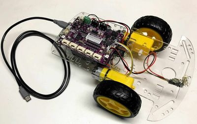{ width="300" }

The club's classic low-cost collision-avoidance robot. It uses a Cytron Maker Pi RP2040 board on a two-wheel SmartCar chassis, needs no soldering, and is the first robot recommended for students; Chapter 19 budgets $18–$25 per robot kit. An OLED display adds about $13.

**Source:** STEM Robots  
**Approximate parts cost:** about $19  
**Link:** [https://dmccreary.github.io/stem-robots/kits/base-bot/](https://dmccreary.github.io/stem-robots/kits/base-bot/)

### Collision Avoidance Robot

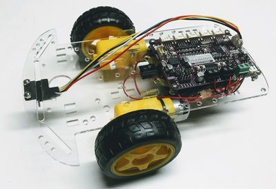{ width="300" }

A Cytron Maker Pi RP2040 robot with a distance sensor that stops, backs up, and turns before hitting obstacles. It is the robot behind the club's collision-avoidance challenge card (Chapter 18).

**Source:** STEM Robots  
**Approximate parts cost:** under $20 (Maker Pi RP2040 board $10, SmartCar chassis $9)  
**Link:** [https://dmccreary.github.io/learning-micropython/kits/maker-pi-rp2040-robot/](https://dmccreary.github.io/learning-micropython/kits/maker-pi-rp2040-robot/)

### Ultrasonic Bot

{ width="300" }

A version of the base robot that uses an HC-SR04 ultrasonic "ping" sensor for distance.

**Source:** STEM Robots  
**Cost:** TBD  
**Link:** [https://dmccreary.github.io/stem-robots/kits/ultrasonic-bot/](https://dmccreary.github.io/stem-robots/kits/ultrasonic-bot/)

### Bump Switch Bot

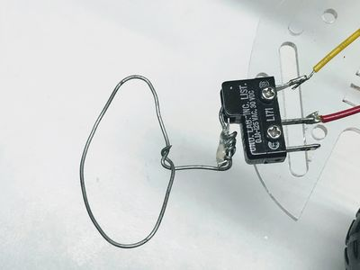{ width="300" }

A robot that detects walls with simple microswitches mounted on the front instead of complex sensors, an idea from Dan's friend Michael York. The microswitches cost under $1.

**Source:** STEM Robots  
**Cost:** TBD  
**Link:** [https://dmccreary.github.io/stem-robots/kits/bump-switch-bot/](https://dmccreary.github.io/stem-robots/kits/bump-switch-bot/)

### Line Follower Bot

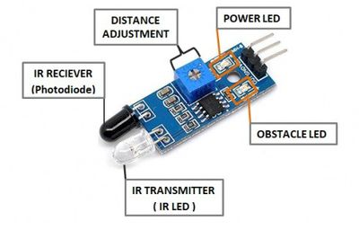{ width="300" }

A robot that follows a line on the floor using TCRT5000 IR reflectance sensors.

**Source:** STEM Robots  
**Cost:** TBD  
**Link:** [https://dmccreary.github.io/stem-robots/kits/line-follower-bot/](https://dmccreary.github.io/stem-robots/kits/line-follower-bot/)

### Adjustabot

A collision-avoidance robot that students "program" by turning knobs that set motor power (speed), the distance threshold for turning, and the turn time. It suits places without a lab of PCs.

**Source:** STEM Robots  
**Cost:** TBD  
**Link:** [https://dmccreary.github.io/stem-robots/kits/adjusta-bot/](https://dmccreary.github.io/stem-robots/kits/adjusta-bot/)

### Display Bot

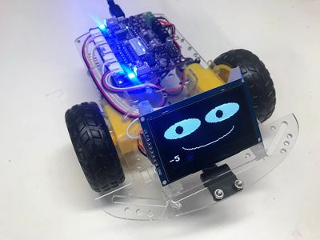{ width="300" }

The base robot with a bright 2.42" 128x64 OLED, large enough to read the robot's numbers while standing over it.

**Source:** STEM Robots  
**Cost:** TBD  
**Link:** [https://dmccreary.github.io/stem-robots/kits/display-bot/](https://dmccreary.github.io/stem-robots/kits/display-bot/)

### Rainbow Bot

The base robot with an 8x8 NeoPixel matrix on top. The colors and patterns change as the robot changes direction.

**Source:** STEM Robots  
**Cost:** TBD  
**Link:** [https://dmccreary.github.io/stem-robots/kits/rainbow-bot/](https://dmccreary.github.io/stem-robots/kits/rainbow-bot/)

### Wireless STEM Robot

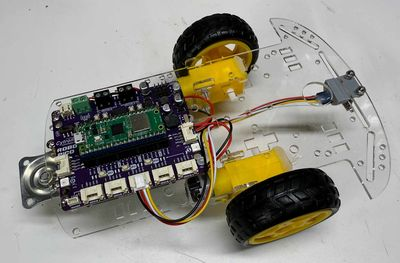{ width="300" }

A robot built on the Cytron Robo Pico board with a Raspberry Pi Pico W, so students can drive it over WiFi or Bluetooth.

**Source:** STEM Robots  
**Cost:** TBD  
**Link:** [https://dmccreary.github.io/stem-robots/kits/wifi-bot/](https://dmccreary.github.io/stem-robots/kits/wifi-bot/)

### WiFi Display Bot

{ width="300" }

The WiFi Bot plus an OLED that shows its status as it connects to WiFi and serves a web-page driver control.

**Source:** STEM Robots  
**Cost:** TBD  
**Link:** [https://dmccreary.github.io/stem-robots/kits/wifi-display-bot/](https://dmccreary.github.io/stem-robots/kits/wifi-display-bot/)

### Swarm Robot

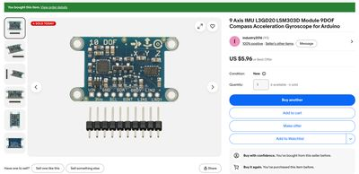{ width="300" }

A build plan for a heading-follower robot swarm, using the Cytron Robo Pico, a Pico W, and an L3GD20 + LSM303DLHC 9-DOF IMU (the module was purchased for $5.96).

**Source:** STEM Robots  
**Cost:** TBD  
**Link:** [https://dmccreary.github.io/stem-robots/kits/swarm-bot/plan/](https://dmccreary.github.io/stem-robots/kits/swarm-bot/plan/)

### MAX98357A I2S Amplifier Kit

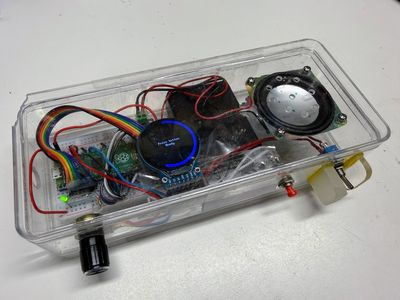{ width="300" }

Replaces the robot's single-tone piezo beep with a class-D amplifier chip that drives a real speaker loud enough to fill a room on three AA batteries.

**Source:** STEM Robots  
**Cost:** TBD (the amplifier chip is about $10)  
**Link:** [https://dmccreary.github.io/stem-robots/kits/max98357a-amp/](https://dmccreary.github.io/stem-robots/kits/max98357a-amp/)

### Synthesizing Robot Sounds

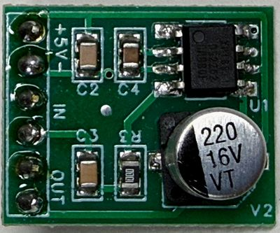{ width="300" }

Makes R2-D2-style robot sounds from a single GPIO pin by switching it on and off at different speeds, with no audio chip and no stored recordings.

**Source:** STEM Robots  
**Cost:** TBD  
**Link:** [https://dmccreary.github.io/stem-robots/kits/synth-sounds/](https://dmccreary.github.io/stem-robots/kits/synth-sounds/)

### OLED Faces Kit

Hands-on labs that draw robot faces on a 128x64 OLED with two buttons, covering every MicroPython framebuffer drawing command.

**Source:** Robot Faces  
**Cost:** TBD  
**Link:** [https://dmccreary.github.io/robot-faces/kits/oled/](https://dmccreary.github.io/robot-faces/kits/oled/)

## Parts Kits

Commercial starter kits and bare controller boards for clubs that want a box of general-purpose parts rather than a single project.

### Value Raspberry Pi Pico Starter Kit (eBay)

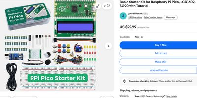{ width="300" }

A value-priced Raspberry Pi Pico starter kit sold on eBay, compared in Chapter 21 as the low end of the starter-kit price range. Prices shown do not include shipping.

**Source:** Commercial starter kit  
**Approximate parts cost:** $30  
**Link:** TBD

### SunFounder Raspberry Pi Pico Starter Kit

{ width="300" }

A mid-range SunFounder Pico starter kit (eBay listing) compared in Chapter 21. Prices shown do not include shipping.

**Source:** Commercial starter kit  
**Approximate parts cost:** $60  
**Link:** TBD

### 52Pi Raspberry Pi Pico W Starter Kit

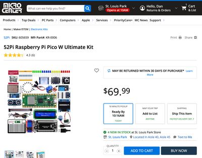{ width="300" }

A Pico W starter kit (Inland/52Pi K-0582) with a breadboard, ultrasonic and PIR sensors, an OLED and an LCD1602, a DHT11, a stepper motor and driver, a servo, a joystick, an MPU6050 gyroscope, LEDs and resistors. Chapter 21 lists it at about $70 at MicroCenter; the Learning MicroPython kit survey lists an eBay listing at $50.

**Source:** Commercial starter kit  
**Approximate parts cost:** about $70 (MicroCenter); $50 (eBay)  
**Link:** [https://www.ebay.com/itm/117067417658](https://www.ebay.com/itm/117067417658)

### SparkFun Inventor's Kit for MicroPython

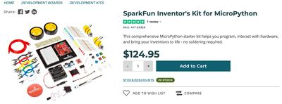{ width="300" }

A higher-end kit from SparkFun with better-quality parts and full MicroPython support. It is the top of the Chapter 21 price comparison.

**Source:** Commercial starter kit  
**Approximate parts cost:** $130  
**Link:** [https://www.sparkfun.com/sparkfun-inventors-kit-for-micropython.html](https://www.sparkfun.com/sparkfun-inventors-kit-for-micropython.html)

### General MicroPython Kits (survey)

Dan's survey of commercial MicroPython starter kits, most built on the Raspberry Pi Pico or Pico 2, plus a few ESP32 kits for wireless projects. It compares kits such as the Seeed Grove Starter Kit ($40) and several eBay Pico kits.

**Source:** Learning MicroPython  
**Approximate parts cost:** $32–$125, depending on the kit  
**Link:** [https://dmccreary.github.io/learning-micropython/kits/01-general-kits/](https://dmccreary.github.io/learning-micropython/kits/01-general-kits/)

### Maker Pi RP2040 Robotics Kit

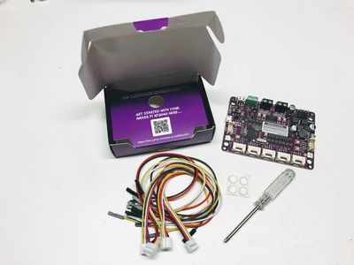{ width="300" }

Cytron's single robotics board with motor drivers, NeoPixels, buttons, a buzzer, and Grove ports. It is the controller for the club's low-cost robots.

**Source:** Learning MicroPython  
**Approximate parts cost:** $9.90 (board)  
**Link:** [https://dmccreary.github.io/learning-micropython/kits/maker-pi-rp2040/](https://dmccreary.github.io/learning-micropython/kits/maker-pi-rp2040/)

### Cytron Maker Pi Pico

A breakout board for the Raspberry Pi Pico with many built-in features (LEDs, buzzer, and more).

**Source:** Learning MicroPython  
**Approximate parts cost:** $9.99 (board)  
**Link:** [https://dmccreary.github.io/learning-micropython/kits/maker-pi-pico/](https://dmccreary.github.io/learning-micropython/kits/maker-pi-pico/)

### Cytron Maker Nano RP2040

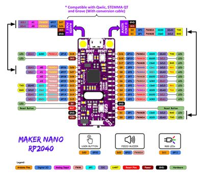{ width="300" }

A low-cost, high-function RP2040 board with 14 GPIO LEDs, 2 NeoPixels, a piezo buzzer, and 2 Grove ports.

**Source:** Learning MicroPython  
**Approximate parts cost:** $9 (board)  
**Link:** [https://dmccreary.github.io/learning-micropython/kits/maker-nano-rp2040/01-intro/](https://dmccreary.github.io/learning-micropython/kits/maker-nano-rp2040/01-intro/)

## Kits Still in Planning

These kits are planned but don't have published kit pages yet: FFT on Pico 2, Frequency Analyzer, SSD1322 OLED Kit (learning-micropython), Moving Rainbow Extras, and Tiki Bar Sign (moving-rainbow).

## Summary Table

| Kit | Source | Approximate Cost | Link |
|---|---|---|---|
| Value Raspberry Pi Pico Starter Kit (eBay) | Commercial starter kit | $30 | TBD |
| SunFounder Raspberry Pi Pico Starter Kit | Commercial starter kit | $60 | TBD |
| 52Pi Raspberry Pi Pico W Starter Kit | Commercial starter kit | about $70 | [Link](https://www.ebay.com/itm/117067417658) |
| SparkFun Inventor's Kit for MicroPython | Commercial starter kit | $130 | [Link](https://www.sparkfun.com/sparkfun-inventors-kit-for-micropython.html) |
| General MicroPython Kits (survey) | Learning MicroPython | $32–$125, depending on the kit | [Link](https://dmccreary.github.io/learning-micropython/kits/01-general-kits/) |
| Moving Rainbow Base Kit | Moving Rainbow | about $15 | [Link](https://dmccreary.github.io/moving-rainbow/kits/moving-rainbow-base/) |
| Tilt-a-Rainbow Kit | Moving Rainbow | $25.50 | [Link](https://dmccreary.github.io/moving-rainbow/kits/16x16-matrix-accel/) |
| Tilt-a-Rainbow Mini Kit | Moving Rainbow | $19.50 | Not yet published |
| 8x8 NeoPixel Matrix Project | Moving Rainbow | about $12 | [Link](https://dmccreary.github.io/moving-rainbow/kits/8x8-neopixel-matrix/) |
| Rotary Spinner Box | Moving Rainbow | about $15 | [Link](https://dmccreary.github.io/moving-rainbow/kits/rotary-spinner-box/) |
| Name Sign Night Light | Moving Rainbow | under $16 | [Link](https://dmccreary.github.io/moving-rainbow/kits/name-sign-night-light/) |
| Digital Nightlight | Moving Rainbow | TBD | [Link](https://dmccreary.github.io/moving-rainbow/kits/digital-nightlight/) |
| Analog Nightlight | Moving Rainbow | about $4–$6 | [Link](https://dmccreary.github.io/moving-rainbow/kits/analog-nightlight/) |
| Nightlight Circuit Design | Moving Rainbow | TBD | [Link](https://dmccreary.github.io/moving-rainbow/kits/nightlight/) |
| LED Noodle Nightlight | Moving Rainbow | TBD | [Link](https://dmccreary.github.io/moving-rainbow/kits/led-noodle-nightlight/) |
| Solar-Powered Nightlight | Moving Rainbow | TBD | [Link](https://dmccreary.github.io/moving-rainbow/kits/solar-powered-led-nightlight/) |
| LED Dimmer | Moving Rainbow | TBD | [Link](https://dmccreary.github.io/moving-rainbow/kits/led-dimmer/) |
| LED Candle Kit | Moving Rainbow | about $10 | [Link](https://dmccreary.github.io/moving-rainbow/kits/led-candle/) |
| Cylon Pumpkin | Moving Rainbow | about $24 | [Link](https://dmccreary.github.io/moving-rainbow/kits/cylon-pumpkin/) |
| Halloween NeoPixel Patterns | Moving Rainbow | TBD | [Link](https://dmccreary.github.io/moving-rainbow/kits/halloween/) |
| Holiday Hats | Moving Rainbow | TBD | [Link](https://dmccreary.github.io/moving-rainbow/kits/holiday-hats/) |
| Jake's Fire | Moving Rainbow | TBD | [Link](https://dmccreary.github.io/moving-rainbow/kits/jakes-fire/) |
| BookStore Sign | Moving Rainbow | TBD | [Link](https://dmccreary.github.io/moving-rainbow/kits/bookstore-sign/) |
| Base STEM Robot | STEM Robots | about $19 | [Link](https://dmccreary.github.io/stem-robots/kits/base-bot/) |
| Collision Avoidance Robot | STEM Robots | under $20 | [Link](https://dmccreary.github.io/learning-micropython/kits/maker-pi-rp2040-robot/) |
| Ultrasonic Bot | STEM Robots | TBD | [Link](https://dmccreary.github.io/stem-robots/kits/ultrasonic-bot/) |
| Bump Switch Bot | STEM Robots | TBD | [Link](https://dmccreary.github.io/stem-robots/kits/bump-switch-bot/) |
| Line Follower Bot | STEM Robots | TBD | [Link](https://dmccreary.github.io/stem-robots/kits/line-follower-bot/) |
| Adjustabot | STEM Robots | TBD | [Link](https://dmccreary.github.io/stem-robots/kits/adjusta-bot/) |
| Display Bot | STEM Robots | TBD | [Link](https://dmccreary.github.io/stem-robots/kits/display-bot/) |
| Rainbow Bot | STEM Robots | TBD | [Link](https://dmccreary.github.io/stem-robots/kits/rainbow-bot/) |
| Wireless STEM Robot | STEM Robots | TBD | [Link](https://dmccreary.github.io/stem-robots/kits/wifi-bot/) |
| WiFi Display Bot | STEM Robots | TBD | [Link](https://dmccreary.github.io/stem-robots/kits/wifi-display-bot/) |
| Swarm Robot | STEM Robots | TBD | [Link](https://dmccreary.github.io/stem-robots/kits/swarm-bot/plan/) |
| Motion Detection Explorer Kit | STEM Robots | TBD | [Link](https://dmccreary.github.io/stem-robots/kits/imu-mpu6050/) |
| 9-DOF IMU Kit | STEM Robots | TBD | [Link](https://dmccreary.github.io/stem-robots/kits/9-dof-imu/) |
| Compass Lab | STEM Robots | TBD | [Link](https://dmccreary.github.io/stem-robots/kits/compass-hmc5883l/) |
| Smartwatch Compass Kit | STEM Robots | TBD | [Link](https://dmccreary.github.io/stem-robots/kits/smartwatch-compass-hmc5883l/) |
| MAX98357A I2S Amplifier Kit | STEM Robots | TBD | [Link](https://dmccreary.github.io/stem-robots/kits/max98357a-amp/) |
| Synthesizing Robot Sounds | STEM Robots | TBD | [Link](https://dmccreary.github.io/stem-robots/kits/synth-sounds/) |
| NeoPixel Kit | Learning MicroPython | under $10 | [Link](https://dmccreary.github.io/learning-micropython/kits/neopixel/) |
| NeoPixel Two Button Kit | Learning MicroPython | about $10 | [Link](https://dmccreary.github.io/learning-micropython/kits/03-neopixel-strip-two-buttons/) |
| Rotary NeoPixel | Learning MicroPython | TBD | [Link](https://dmccreary.github.io/learning-micropython/kits/03-rotary-neopixel/) |
| Raspberry Pi RGB Box | Learning MicroPython | about $15 | [Link](https://dmccreary.github.io/learning-micropython/kits/rgb-box/) |
| Larson Scanner Pumpkin | Learning MicroPython | about $24 plus a battery pack | [Link](https://dmccreary.github.io/learning-micropython/kits/larson-scanner/01-intro/) |
| Pulse Width Modulation Kit | Learning MicroPython | about $19 | [Link](https://dmccreary.github.io/learning-micropython/kits/pwm/) |
| Tone Generator | Learning MicroPython | under $10 | [Link](https://dmccreary.github.io/learning-micropython/kits/tone-generator/) |
| Distance Sensor Box | Learning MicroPython | TBD | [Link](https://dmccreary.github.io/learning-micropython/kits/distance-sensor/) |
| MAX4466 Microphone Kit | Learning MicroPython | TBD | [Link](https://dmccreary.github.io/learning-micropython/kits/microphone-max4466/) |
| Spectrum Analyzer Kit | Learning MicroPython | TBD | [Link](https://dmccreary.github.io/spectrum-analyzer/) |
| SHT40 Temperature and Humidity | Learning MicroPython | TBD | [Link](https://dmccreary.github.io/learning-micropython/kits/sht40-temp/) |
| Mood Ring Thermometer | Learning MicroPython | about $11 | [Link](https://dmccreary.github.io/learning-micropython/kits/sht40-temp-display/) |
| RC522 RFID Kit | Learning MicroPython | TBD | [Link](https://dmccreary.github.io/learning-micropython/kits/rfid-rc522/) |
| Maker Pi RP2040 Robotics Kit | Learning MicroPython | $9.90 | [Link](https://dmccreary.github.io/learning-micropython/kits/maker-pi-rp2040/) |
| Cytron Maker Pi Pico | Learning MicroPython | $9.99 | [Link](https://dmccreary.github.io/learning-micropython/kits/maker-pi-pico/) |
| Cytron Maker Nano RP2040 | Learning MicroPython | $9 | [Link](https://dmccreary.github.io/learning-micropython/kits/maker-nano-rp2040/01-intro/) |
| Chrono Smart Clock Kit | Clocks and Watches | under $20 | [Link](https://dmccreary.github.io/clocks-and-watches/kits/sw-gc9b72/) |
| Study Buddy Kit | Clocks and Watches | TBD | [Link](https://dmccreary.github.io/clocks-and-watches/kits/study-buddy/) |
| Knob Clock Kit | Clocks and Watches | TBD | [Link](https://dmccreary.github.io/clocks-and-watches/kits/rect-tft-display/) |
| Large OLED Kit | Clocks and Watches | TBD | [Link](https://dmccreary.github.io/clocks-and-watches/kits/oled-large/) |
| Tiny SSD1306 I2C OLED Clock | Clocks and Watches | TBD | [Link](https://dmccreary.github.io/clocks-and-watches/kits/ssd1306-i2c/) |
| SH1106 OLED Driver Kit | Clocks and Watches | TBD | [Link](https://dmccreary.github.io/clocks-and-watches/kits/sh1106/) |
| ST7735 Digital Clock | Clocks and Watches | under $10 | [Link](https://dmccreary.github.io/clocks-and-watches/kits/st7735/) |
| ILI9341 Display Kit | Clocks and Watches | TBD | [Link](https://dmccreary.github.io/clocks-and-watches/kits/ili9341/) |
| GC9A01 Display Kit | Clocks and Watches | TBD | [Link](https://dmccreary.github.io/clocks-and-watches/kits/gc9a01/) |
| LILYGO T-Display RP2040 Kit | Clocks and Watches | about $11 | [Link](https://dmccreary.github.io/clocks-and-watches/kits/lilygo/) |
| Waveshare RP2040 LCD | Clocks and Watches | about $18 | [Link](https://dmccreary.github.io/clocks-and-watches/kits/waveshare-lcd/) |
| Portable Smartwatch Kits | Clocks and Watches | about $15–$20 plus a battery | [Link](https://dmccreary.github.io/clocks-and-watches/kits/portable-watch-kits/) |
| Character LCD Clock | Clocks and Watches | TBD | [Link](https://dmccreary.github.io/clocks-and-watches/kits/char-lcd-clock/) |
| LED Display Clock | Clocks and Watches | under $10 | [Link](https://dmccreary.github.io/clocks-and-watches/kits/led-displays/) |
| TM1637 LED Display | Clocks and Watches | TBD | [Link](https://dmccreary.github.io/clocks-and-watches/kits/tm1637/) |
| TM1650 LED Clock | Clocks and Watches | TBD | [Link](https://dmccreary.github.io/clocks-and-watches/kits/tm1650-led-clock/) |
| MAX7219 Clocks | Clocks and Watches | TBD | [Link](https://dmccreary.github.io/clocks-and-watches/kits/max7219/) |
| 74HC595 Shift Register Clock | Clocks and Watches | TBD | [Link](https://dmccreary.github.io/clocks-and-watches/kits/shift-register-clock/) |
| NeoPixel LED Strip Clock Kits | Clocks and Watches | TBD | [Link](https://dmccreary.github.io/clocks-and-watches/kits/neopixel/) |
| Stopwatch | Clocks and Watches | TBD | [Link](https://dmccreary.github.io/clocks-and-watches/kits/stopwatch/) |
| Alarm Clocks | Clocks and Watches | TBD | [Link](https://dmccreary.github.io/clocks-and-watches/kits/alarm-clock/) |
| OLED Wireless Weather Kit | Clocks and Watches | TBD | [Link](https://dmccreary.github.io/clocks-and-watches/kits/oled-wireless/) |
| E-Ink Displays | Clocks and Watches | TBD | [Link](https://dmccreary.github.io/clocks-and-watches/kits/e-paper/) |
| Waveshare E-Paper Display | Clocks and Watches | TBD | [Link](https://dmccreary.github.io/clocks-and-watches/kits/waveshare-e-paper/) |
| OLED Faces Kit | Robot Faces | TBD | [Link](https://dmccreary.github.io/robot-faces/kits/oled/) |
| 1.2" Smartwatch Kit | Robot Faces | under $10 | [Link](https://dmccreary.github.io/robot-faces/kits/smartwatch/) |
| 2.1" Smartwatch Kit | Robot Faces | TBD | [Link](https://dmccreary.github.io/robot-faces/kits/sw-gc9b72/) |
