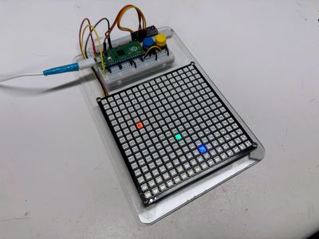

# Tilt-a-Rainbow Kit

{ width="420" }

A 16x16 NeoPixel matrix (256 pixels) with a LIS3DH accelerometer, so tilting the board rolls the lights around. It has two buttons to change modes.

**Source book:** Moving Rainbow  
**Kit page:** [https://dmccreary.github.io/moving-rainbow/kits/16x16-matrix-accel/](https://dmccreary.github.io/moving-rainbow/kits/16x16-matrix-accel/)  
**Printable one-pager:** [16x16-matrix-accel-one-pager.html](16x16-matrix-accel-one-pager.html)

## Features

- Wire a light matrix, a tilt sensor, and two buttons to a Raspberry Pi Pico.
- Test each part by itself before you put them together.
- Turn a row and a column into a pixel number.
- Read the tilt sensor and use it to move lights.
- Run ten different light shows from one program.

## Benefits

- Free, open lessons: the Moving Rainbow textbook has the kit page, wiring, and MicroPython code.
- Ready-made curriculum: 13 additional lab pages walk students through the build step by step.
- Classroom friendly: built on a solderless breadboard or no-solder connectors.
- Budget: $20.99.

## Parts

- **Raspberry Pi Pico ($4)** — Microcontroller
- **LIS3DH** — Sensor
- **Momentary Push Buttons** — Input button / switch
- **WS2812B 16x16 NeoPixel Matrix ($5.49)** — LEDs (256 pixels)
- **ADXL345** — Sensor
- **830-Point Breadboard ($1.10)** — Breadboard
- **Micro-USB Data Cable ($2.50)** — Power and programming cable
