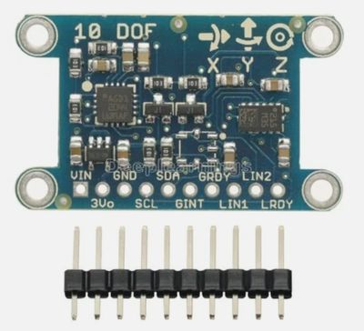

# 9-DOF IMU Kit

!!! note "Kit photo needed"
    We don't have a photo of the assembled kit yet. The image below shows a key part.

{ width="320" }

*Key part: 10-DOF IMU sensor board*

Wires a 9-axis motion sensor to a bare Pico and shows live numbers proving a robot can sense which way it is turning.

**Source book:** STEM Robots  
**Kit page:** [https://dmccreary.github.io/stem-robots/kits/9-dof-imu/](https://dmccreary.github.io/stem-robots/kits/9-dof-imu/)  
**Printable one-pager:** [9-dof-imu-one-pager.html](9-dof-imu-one-pager.html)

## Features

- Uses the HMC5883L / QMC5883L Compass
- Uses the MPU6050
- Uses the MPU9250
- Uses the Raspberry Pi Pico RP2040

## Benefits

- Free, open lessons: the STEM Robots textbook has the kit page, wiring, and MicroPython code.
- Classroom friendly: built on a solderless breadboard or no-solder connectors.
- Real-world data: students read sensors and turn measurements into decisions.
- Budget: about $15 (L3GD20/LSM303 module about $7–$9 on eBay, Pico $4, wires $1, USB cable $2).

## Parts

- **Raspberry Pi Pico ($4)** — Microcontroller
- **HMC5883L / QMC5883L Compass** — Sensor
- **MPU6050** — Sensor
- **MPU9250** — Sensor
- **830-Point Breadboard ($1.10)** — Breadboard
- **Micro-USB Data Cable ($2.50)** — Power and programming cable
