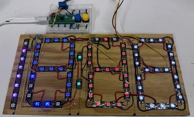

# NeoPixel LED Strip Clock Kits

{ width="420" }

Three art clocks, including a binary clock, built from a strip of low-cost WS2812B NeoPixels.

**Source book:** Clocks and Watches  
**Kit page:** [https://dmccreary.github.io/clocks-and-watches/kits/neopixel/](https://dmccreary.github.io/clocks-and-watches/kits/neopixel/)  
**Printable one-pager:** [clocks-and-watches-neopixel-one-pager.html](clocks-and-watches-neopixel-one-pager.html)

## Features

- Uses the DS3231 RTC
- Uses the Raspberry Pi Pico RP2040
- Uses the WS2812B NeoPixels

## Benefits

- Free, open lessons: the Clocks and Watches textbook has the kit page, wiring, and MicroPython code.
- Budget: about $14 (NeoPixel strip about $5 per meter; Pico $4, breadboard $2, wires $1, USB cable $2).

## Parts

- **Raspberry Pi Pico ($4)** — Microcontroller
- **DS3231 RTC** — Real-time clock
- **WS2812B NeoPixels** — LEDs
- **830-Point Breadboard ($1.10)** — Breadboard
- **Micro-USB Data Cable ($2.50)** — Power and programming cable
