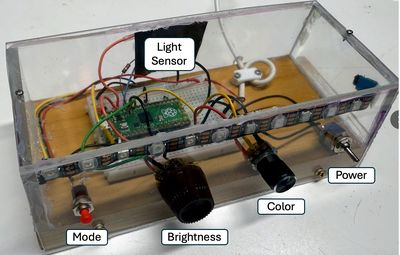

# Digital Nightlight

{ width="420" }

A Pico on a breadboard with a button, two potentiometers, a power switch, and a photoresistor, so the LED strip shows a pattern only when the room is dark.

**Source book:** Moving Rainbow  
**Kit page:** [https://dmccreary.github.io/moving-rainbow/kits/digital-nightlight/](https://dmccreary.github.io/moving-rainbow/kits/digital-nightlight/)  
**Printable one-pager:** [digital-nightlight-one-pager.html](digital-nightlight-one-pager.html)

## Features

- Uses the 10K Potentiometer
- Uses the LDR Photoresistor
- Uses the Raspberry Pi Pico RP2040
- Uses the WS2812B NeoPixels

## Benefits

- Free, open lessons: the Moving Rainbow textbook has the kit page, wiring, and MicroPython code.
- Classroom friendly: built on a solderless breadboard or no-solder connectors.
- Real-world data: students read sensors and turn measurements into decisions.
- Budget: about $16 (estimate: the $15 Moving Rainbow base parts plus two potentiometers and a photoresistor, each about $1 or less).

## Parts

- **Raspberry Pi Pico ($4)** — Microcontroller
- **10K Potentiometer** — Input knob
- **LDR Photoresistor** — Sensor
- **WS2812B NeoPixels** — LEDs
- **830-Point Breadboard ($1.10)** — Breadboard
- **Micro-USB Data Cable ($2.50)** — Power and programming cable
