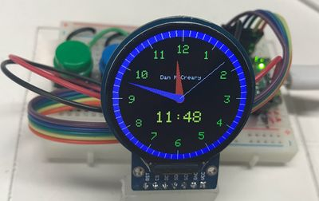

# GC9A01 Display Kit

{ width="420" }

A 240x240 round color display connected over SPI, used for watch faces.

**Source book:** Clocks and Watches  
**Kit page:** [https://dmccreary.github.io/clocks-and-watches/kits/gc9a01/](https://dmccreary.github.io/clocks-and-watches/kits/gc9a01/)  
**Printable one-pager:** [gc9a01-one-pager.html](gc9a01-one-pager.html)

## Features

- Lab: Hello World Test
- Lab: Display Time and Date
- Lab: Display Second Hand
- Lab: Cycle Through the Builtin Fonts
- Lab: Draw Clock Face Ticks
- Lab: Draw Clock Dial Digits

## Benefits

- Free, open lessons: the Clocks and Watches textbook has the kit page, wiring, and MicroPython code.
- Ready-made curriculum: 8 additional lab pages walk students through the build step by step.
- Wireless-ready: the Pico W option adds Wi-Fi for time sync and web projects.
- Instant feedback: students see their code's results on lights or a display.
- Budget: about $13 (round display $3.19, Pico W $5, breadboard $2, wires $1, USB cable $2).

## Parts

- **Raspberry Pi Pico ($4)** — Microcontroller
- **GC9A01 Round TFT ($3.19)** — Display
- **830-Point Breadboard ($1.10)** — Breadboard
- **Micro-USB Data Cable ($2.50)** — Power and programming cable
