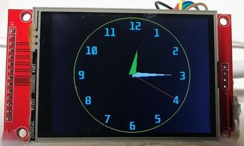

# ILI9341 Display Kit

{ width="420" }

A 240x320 color TFT that can draw smooth analog clock faces.

**Source book:** Clocks and Watches  
**Kit page:** [https://dmccreary.github.io/clocks-and-watches/kits/ili9341/](https://dmccreary.github.io/clocks-and-watches/kits/ili9341/)  
**Printable one-pager:** [ili9341-one-pager.html](ili9341-one-pager.html)

## Features

- Lab: Rainbow Test
- Lab: Creating a Hardware Configuration File

## Benefits

- Free, open lessons: the Clocks and Watches textbook has the kit page, wiring, and MicroPython code.
- Ready-made curriculum: 2 additional lab pages walk students through the build step by step.
- Instant feedback: students see their code's results on lights or a display.
- Budget: about $17 (2.4"–2.8" display about $6–$8.50, Pico W $5, breadboard $2, wires $1, USB cable $2).

## Parts

- **Raspberry Pi Pico ($4)** — Microcontroller
- **ILI9341 2.8" TFT** — Display
- **830-Point Breadboard ($1.10)** — Breadboard
- **Micro-USB Data Cable ($2.50)** — Power and programming cable
