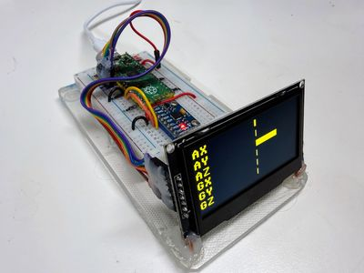

# Motion Detection Explorer Kit

{ width="420" }

A boxed kit for learning how robots sense motion with the MPU6050 MEMS accelerometer/gyroscope, with readings shown on an OLED.

**Source book:** STEM Robots  
**Kit page:** [https://dmccreary.github.io/stem-robots/kits/imu-mpu6050/](https://dmccreary.github.io/stem-robots/kits/imu-mpu6050/)  
**Printable one-pager:** [imu-mpu6050-one-pager.html](imu-mpu6050-one-pager.html)

## Features

- Uses the HMC5883L / QMC5883L Compass
- Uses the MPU6050
- Uses the Raspberry Pi Pico RP2040
- Uses the SSD1306 128×64 OLED

## Benefits

- Free, open lessons: the STEM Robots textbook has the kit page, wiring, and MicroPython code.
- Classroom friendly: built on a solderless breadboard or no-solder connectors.
- Instant feedback: students see their code's results on lights or a display.
- Real-world data: students read sensors and turn measurements into decisions.
- Budget: about $15 (MPU6050 module about $1–$3, 0.96" OLED about $4.40; Pico $4, breadboard $2, wires $1, USB cable $2), plus the box.

## Parts

- **Raspberry Pi Pico ($4)** — Microcontroller
- **HMC5883L / QMC5883L Compass** — Sensor
- **MPU6050** — Sensor
- **SSD1306 128×64 OLED** — Display
- **830-Point Breadboard ($1.10)** — Breadboard
- **Micro-USB Data Cable ($2.50)** — Power and programming cable
