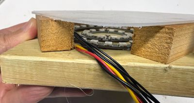

# Jake's Fire

{ width="420" }

A small, color-changing tabletop campfire made from programmable RGB LEDs, built from a student's request.

**Source book:** Moving Rainbow  
**Kit page:** [https://dmccreary.github.io/moving-rainbow/kits/jakes-fire/](https://dmccreary.github.io/moving-rainbow/kits/jakes-fire/)  
**Printable one-pager:** [jakes-fire-one-pager.html](jakes-fire-one-pager.html)

## Features

- Lab: Jake's Fire - Advanced Version

## Benefits

- Free, open lessons: the Moving Rainbow textbook has the kit page, wiring, and MicroPython code.
- Try before you build: an interactive MicroSim on the kit page runs in the browser.
- Budget: about $11 (estimate: Pico $4, breadboard $2, USB cable $2, and a few RGB LEDs about $3).

## Parts

- **Raspberry Pi Pico ($4)** — Microcontroller
- **10K Potentiometer** — Input knob
- **WS2812B NeoPixels** — LEDs
- **830-Point Breadboard ($1.10)** — Breadboard
- **Micro-USB Data Cable ($2.50)** — Power and programming cable
