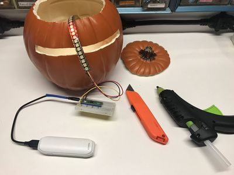

# Larson Scanner Pumpkin

{ width="420" }

The Knight Rider/Cylon "scanner" light effect on a 144-pixel-per-meter LED strip glued into a craft pumpkin.

**Source book:** Learning MicroPython  
**Kit page:** [https://dmccreary.github.io/learning-micropython/kits/larson-scanner/](https://dmccreary.github.io/learning-micropython/kits/larson-scanner/)  
**Printable one-pager:** [larson-scanner-one-pager.html](larson-scanner-one-pager.html)

## Features

- Uses the 10K Potentiometer
- Uses the Cytron Maker Pi RP2040
- Uses the HC-SR501 PIR
- Uses the Raspberry Pi Pico RP2040
- Uses the WS2812B NeoPixels

## Benefits

- Free, open lessons: the Learning MicroPython textbook has the kit page, wiring, and MicroPython code.
- Classroom friendly: built on a solderless breadboard or no-solder connectors.
- Try before you build: an interactive MicroSim on the kit page runs in the browser.
- Budget: about $24 plus a battery pack (pumpkin $10, Pico $4, breadboard $2, LED strip $8).

## Parts

- **Raspberry Pi Pico ($4)** — Microcontroller
- **Cytron Maker Pi RP2040** — Microcontroller
- **10K Potentiometer** — Input knob
- **HC-SR501 PIR** — Sensor
- **WS2812B NeoPixels** — LEDs
- **830-Point Breadboard ($1.10)** — Breadboard
- **Micro-USB Data Cable ($2.50)** — Power and programming cable
