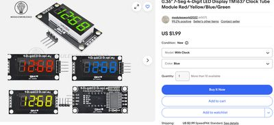

# LED Display Clock

!!! note "Kit photo needed"
    We don't have a photo of the assembled kit yet. The image below shows a key part.

{ width="320" }

*Key part: 4-digit LED display module*

A clock using the TM1637 4-digit LED display module.

**Source book:** Clocks and Watches  
**Kit page:** [https://dmccreary.github.io/clocks-and-watches/kits/led-displays/](https://dmccreary.github.io/clocks-and-watches/kits/led-displays/)  
**Printable one-pager:** [led-displays-one-pager.html](led-displays-one-pager.html)

## Features

- Lab: A Simple Clock with the TM1637 LED Display
- Lab: Programming Reference for the TM1637 Clock LED Driver
- Lab: Shift Register Displays

## Benefits

- Free, open lessons: the Clocks and Watches textbook has the kit page, wiring, and MicroPython code.
- Ready-made curriculum: 3 additional lab pages walk students through the build step by step.
- Wireless-ready: the Pico W option adds Wi-Fi for time sync and web projects.
- Instant feedback: students see their code's results on lights or a display.
- Budget: under $10.

## Parts

- **Raspberry Pi Pico ($4)** — Microcontroller
- **74HC595 Shift Register** — Output expander
- **Piezo Buzzer / Speaker** — Sound output
- **TM1637 4-Digit LED** — Display
- **830-Point Breadboard ($1.10)** — Breadboard
- **Micro-USB Data Cable ($2.50)** — Power and programming cable
