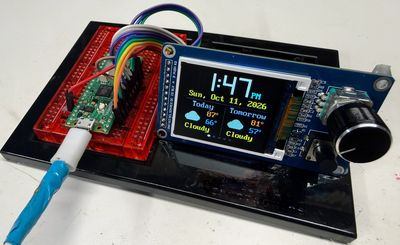

# Knob Clock Kit

{ width="420" }

A color-screen clock with one turn-and-press knob and one button. Students start by blinking a light and finish with five clock faces.

**Source book:** Clocks and Watches  
**Kit page:** [https://dmccreary.github.io/clocks-and-watches/kits/rect-tft-display/](https://dmccreary.github.io/clocks-and-watches/kits/rect-tft-display/)  
**Printable one-pager:** [rect-tft-display-one-pager.html](rect-tft-display-one-pager.html)

## Features

- Set its own time. It asks the internet what time it is.
- Show the time your way. Choose big digital numbers, or a clock face
- Tell you the weather. Today's and tomorrow's forecast appear with
- Time laps and count down. It works as a stopwatch that records
- Switch with a turn of the knob. Turn the knob to step through all

## Benefits

- Free, open lessons: the Clocks and Watches textbook has the kit page, wiring, and MicroPython code.
- Ready-made curriculum: 18 additional lab pages walk students through the build step by step.
- Classroom friendly: built on a solderless breadboard or no-solder connectors.
- Wireless-ready: the Pico W option adds Wi-Fi for time sync and web projects.
- Instant feedback: students see their code's results on lights or a display.
- Real-world data: students read sensors and turn measurements into decisions.
- Budget: about $16 (display board with knob and button $5.53, Pico 2 W about $5, breadboard $2, wires $1, USB cable $2).

## Parts

- **Raspberry Pi Pico W ($5)** — Microcontroller with Wireless
- **GC9B72 Smartwatch Display ($5.39)** — Display
- **Momentary Push Buttons** — Input button / switch
- **Piezo Buzzer / Speaker** — Sound output
- **KY-040 Rotary Encoder** — Input knob
- **ST7735 1.8" TFT** — Display
- **ST7789 TFT** — Display
- **830-Point Breadboard ($1.10)** — Breadboard
- **Micro-USB Data Cable ($2.50)** — Power and programming cable
