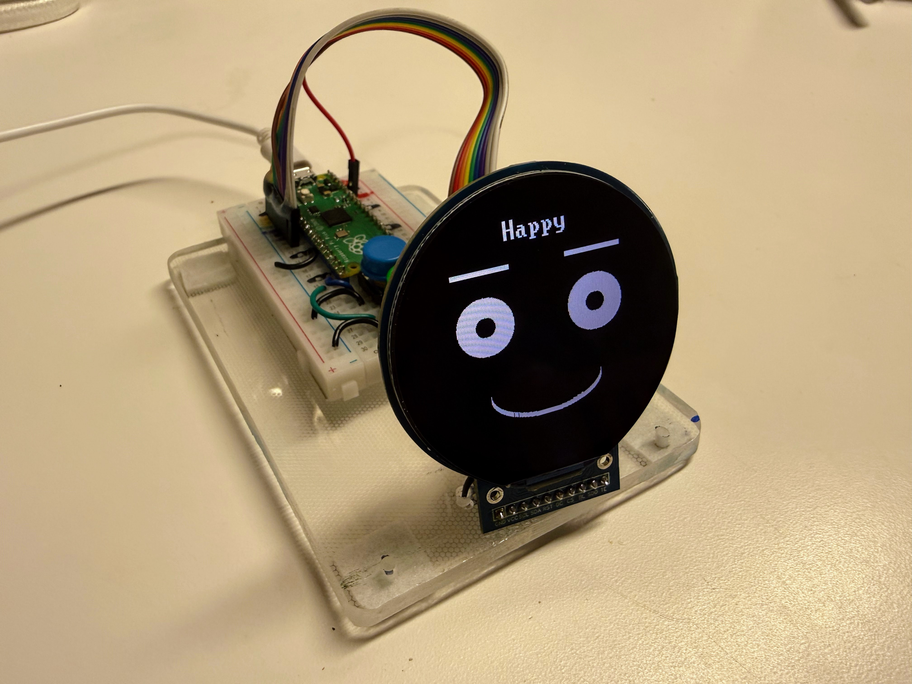

# 2.1" Smartwatch Kit

{ width="420" }

The same labs on a bigger 360x360 round GC9B72 display. A copy of this kit is also the demo kit at The Thinking Spot.

Also published in Thinking Spot Demos: https://dmccreary.github.io/thinking-spot-demos/kits/sw-gc9b72/

**Source book:** Robot Faces  
**Kit page:** [https://dmccreary.github.io/robot-faces/kits/sw-gc9b72/](https://dmccreary.github.io/robot-faces/kits/sw-gc9b72/)  
**Printable one-pager:** [robot-faces-sw-gc9b72-one-pager.html](robot-faces-sw-gc9b72-one-pager.html)

## Features

- Uses the GC9A01 Round TFT
- Uses the GC9B72 Smartwatch Display
- Uses the Momentary Push Buttons
- Uses the Raspberry Pi Pico RP2040
- Uses the SSD1306 128×64 OLED

## Benefits

- Free, open lessons: the Robot Faces textbook has the kit page, wiring, and MicroPython code.
- Classroom friendly: built on a solderless breadboard or no-solder connectors.
- Instant feedback: students see their code's results on lights or a display.
- Budget: about $10 with the $6.12 AliExpress display, or about $26 with an eBay display (about $22), plus a Pico about $4.

## Parts

- **Raspberry Pi Pico ($4)** — Microcontroller
- **GC9A01 Round TFT ($3.19)** — Display
- **GC9B72 Smartwatch Display ($5.39)** — Display
- **Momentary Push Buttons** — Input button / switch
- **SSD1306 128×64 OLED** — Display
- **830-Point Breadboard ($1.10)** — Breadboard
- **Micro-USB Data Cable ($2.50)** — Power and programming cable
