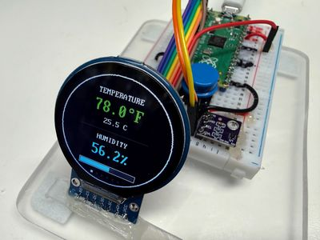

# Mood Ring Thermometer

{ width="420" }

The SHT40 sensor paired with a low-cost round GC9A01 "smartwatch" display that changes color with the temperature.

**Source book:** Learning MicroPython  
**Kit page:** [https://dmccreary.github.io/learning-micropython/kits/sht40-temp-display/](https://dmccreary.github.io/learning-micropython/kits/sht40-temp-display/)  
**Printable one-pager:** [sht40-temp-display-one-pager.html](sht40-temp-display-one-pager.html)

## Features

- Wire a sensor and a round color screen to a Raspberry Pi Pico.
- Test each part on its own before you put them together.
- Explain what a pixel is and how x and y numbers find a spot on the screen.
- Change a temperature from Celsius to Fahrenheit.
- Read a short program and explain how it picks a color.
- Change a setting and predict what the display will show.

## Benefits

- Free, open lessons: the Learning MicroPython textbook has the kit page, wiring, and MicroPython code.
- Classroom friendly: built on a solderless breadboard or no-solder connectors.
- Wireless-ready: the Pico W option adds Wi-Fi for time sync and web projects.
- Instant feedback: students see their code's results on lights or a display.
- Real-world data: students read sensors and turn measurements into decisions.
- Budget: about $9 (sum of the listed parts: Pico $4, SHT40 $1.65, GC9A01 display $3.19).

## Parts

- **Raspberry Pi Pico ($4)** — Microcontroller
- **GC9A01 Round TFT ($3.19)** — Display
- **Momentary Push Buttons** — Input button / switch
- **SHT40** — Sensor
- **830-Point Breadboard ($1.10)** — Breadboard
- **Micro-USB Data Cable ($2.50)** — Power and programming cable
