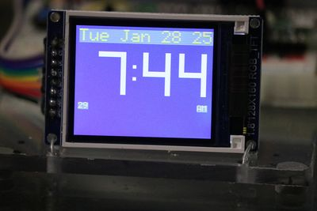

# ST7735 Digital Clock

{ width="420" }

A low-cost 1.8" 160x128 color LCD clock, an ideal starter color display for clock kits.

**Source book:** Clocks and Watches  
**Kit page:** [https://dmccreary.github.io/clocks-and-watches/kits/st7735/](https://dmccreary.github.io/clocks-and-watches/kits/st7735/)  
**Printable one-pager:** [st7735-one-pager.html](st7735-one-pager.html)

## Features

- Built-in font support for text rendering
- Efficient drawing primitives for shapes and lines
- Support for bitmap images
- Anti-flicker optimization in the clock code through selective updates
- Segment-based digit drawing for custom numerical displays

## Benefits

- Free, open lessons: the Clocks and Watches textbook has the kit page, wiring, and MicroPython code.
- Ready-made curriculum: 7 additional lab pages walk students through the build step by step.
- Instant feedback: students see their code's results on lights or a display.
- Budget: under $10 (the display is about $3.50).

## Parts

- **Raspberry Pi Pico ($4)** — Microcontroller
- **ST7735 1.8" TFT** — Display
- **830-Point Breadboard ($1.10)** — Breadboard
- **Micro-USB Data Cable ($2.50)** — Power and programming cable
