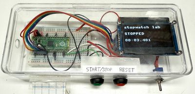

# Stopwatch

{ width="420" }

A two-button stopwatch (Start/Stop and Reset) on an OLED display.

**Source book:** Clocks and Watches  
**Kit page:** [https://dmccreary.github.io/clocks-and-watches/kits/stopwatch/](https://dmccreary.github.io/clocks-and-watches/kits/stopwatch/)  
**Printable one-pager:** [stopwatch-one-pager.html](stopwatch-one-pager.html)

## Features

- Uses the Raspberry Pi Pico RP2040
- Uses the SSD1306 128×64 OLED

## Benefits

- Free, open lessons: the Clocks and Watches textbook has the kit page, wiring, and MicroPython code.
- Try before you build: an interactive MicroSim on the kit page runs in the browser.
- Instant feedback: students see their code's results on lights or a display.
- Budget: about $14 (0.96" OLED about $4.40, two buttons about $0.50; Pico $4, breadboard $2, wires $1, USB cable $2).

## Parts

- **Raspberry Pi Pico ($4)** — Microcontroller
- **SSD1306 128×64 OLED** — Display
- **830-Point Breadboard ($1.10)** — Breadboard
- **Micro-USB Data Cable ($2.50)** — Power and programming cable
