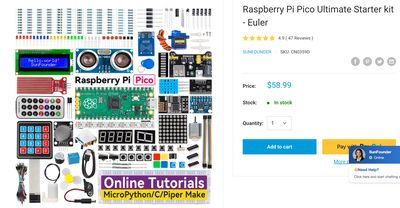

# SunFounder Raspberry Pi Pico Starter Kit

!!! note "Kit photo needed"
    We don't have a photo of the assembled kit yet. The image below shows a key part.

{ width="320" }

*Store listing photo*

A mid-range SunFounder Pico starter kit (eBay listing) compared in Chapter 21. Prices shown do not include shipping.

**Source book:** Commercial Starter Kits  
**Kit page:** [https://www.ebay.com/sch/i.html?_nkw=SunFounder+raspberry+pi+pico+w+ultimate+starter+kit](https://www.ebay.com/sch/i.html?_nkw=SunFounder+raspberry+pi+pico+w+ultimate+starter+kit)  
**Printable one-pager:** [sunfounder-raspberry-pi-pico-starter-kit-one-pager.html](sunfounder-raspberry-pi-pico-starter-kit-one-pager.html)

## Features

- See the kit page for details.

## Benefits

- Budget: about $45–$60 (the SunFounder Pico W Ultimate Starter Kit is about $45–$53 new on eBay; some sellers ask $90 or more).
- One box of general-purpose parts covers many club projects.
- Useful as a price benchmark when budgeting club kits (Chapter 21).

## Parts

No parts list has been recorded for this kit yet.
