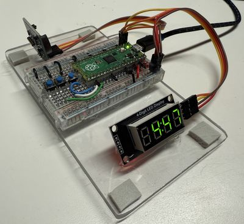

# TM1637 LED Display

{ width="420" }

A very popular, low-cost 4-digit 7-segment module for clocks, counters, and other number displays.

**Source book:** Clocks and Watches  
**Kit page:** [https://dmccreary.github.io/clocks-and-watches/kits/tm1637/](https://dmccreary.github.io/clocks-and-watches/kits/tm1637/)  
**Printable one-pager:** [tm1637-one-pager.html](tm1637-one-pager.html)

## Features

- Lab: TM1637 MicroPython Clock Program - Code Walkthrough
- Lab: Manually Setting the Time
- Lab: Full Running Clock Using the TM1637

## Benefits

- Free, open lessons: the Clocks and Watches textbook has the kit page, wiring, and MicroPython code.
- Ready-made curriculum: 3 additional lab pages walk students through the build step by step.
- Classroom friendly: built on a solderless breadboard or no-solder connectors.
- Try before you build: an interactive MicroSim on the kit page runs in the browser.
- Wireless-ready: the Pico W option adds Wi-Fi for time sync and web projects.
- Instant feedback: students see their code's results on lights or a display.
- Budget: about $10 (display about $1 on eBay, or $0.30 in bulk; Pico $4, breadboard $2, wires $1, USB cable $2).

## Parts

- **Raspberry Pi Pico ($4)** — Microcontroller
- **DS3231 RTC** — Real-time clock
- **Piezo Buzzer / Speaker** — Sound output
- **TM1637 4-Digit LED** — Display
- **830-Point Breadboard ($1.10)** — Breadboard
- **Micro-USB Data Cable ($2.50)** — Power and programming cable
