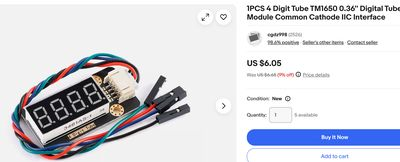

# TM1650 LED Clock

!!! note "Kit photo needed"
    We don't have a photo of the assembled kit yet. The image below shows a key part.

{ width="320" }

*Key part: TM1650 4-digit display (store listing)*

A four-digit seven-segment clock driven by the TM1650 LED driver chip.

**Source book:** Clocks and Watches  
**Kit page:** [https://dmccreary.github.io/clocks-and-watches/kits/tm1650-led-clock/](https://dmccreary.github.io/clocks-and-watches/kits/tm1650-led-clock/)  
**Printable one-pager:** [tm1650-led-clock-one-pager.html](tm1650-led-clock-one-pager.html)

## Features

- Uses the TM1650 4-Digit LED

## Benefits

- Free, open lessons: the Clocks and Watches textbook has the kit page, wiring, and MicroPython code.
- Instant feedback: students see their code's results on lights or a display.
- Budget: about $16 (display about $7 on eBay; Pico $4, breadboard $2, wires $1, USB cable $2).

## Parts

- **TM1650 4-Digit LED** — Display
- **830-Point Breadboard ($1.10)** — Breadboard
- **Micro-USB Data Cable ($2.50)** — Power and programming cable
