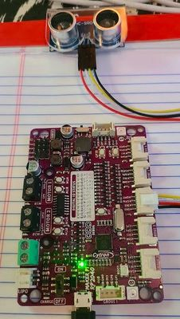

# Ultrasonic Bot

{ width="420" }

A version of the base robot that uses an HC-SR04 ultrasonic "ping" sensor for distance.

**Source book:** STEM Robots  
**Kit page:** [https://dmccreary.github.io/stem-robots/kits/ultrasonic-bot/](https://dmccreary.github.io/stem-robots/kits/ultrasonic-bot/)  
**Printable one-pager:** [ultrasonic-bot-one-pager.html](ultrasonic-bot-one-pager.html)

## Features

- Lab: Ultrasonic Ping Sensor Lab

## Benefits

- Free, open lessons: the STEM Robots textbook has the kit page, wiring, and MicroPython code.
- Real-world data: students read sensors and turn measurements into decisions.
- Budget: about $20 (base robot $19 plus an HC-SR04 sensor about $1).

## Parts

- **Cytron Maker Pi RP2040 ($10)** — Controller board (built-in RP2040)
- **HC-SR04 Ultrasonic Sensor** — Sensor
- **Piezo Buzzer / Speaker** — Sound output
- **830-Point Breadboard ($1.10)** — Breadboard
- **Micro-USB Data Cable ($2.50)** — Power and programming cable
