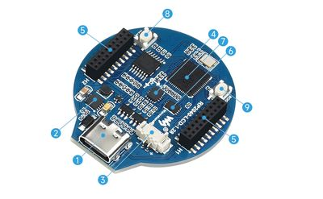

# Waveshare RP2040

!!! note "Kit photo needed"
    We don't have a photo of the assembled kit yet. The image below shows a key part.

{ width="320" }

*Key part: Waveshare RP2040 round LCD board*

A development board with a 1.28" round IPS LCD, USB-C, a LiPo battery connector, and a built-in accelerometer and gyroscope.

**Source book:** Clocks and Watches  
**Kit page:** [https://dmccreary.github.io/clocks-and-watches/kits/waveshare-lcd/](https://dmccreary.github.io/clocks-and-watches/kits/waveshare-lcd/)  
**Printable one-pager:** [waveshare-lcd-one-pager.html](waveshare-lcd-one-pager.html)

## Features

- Lab: Waveshare Hello World
- Lab: Color Tests
- Lab: Display Time and Date in Text
- Lab: Drawing Analog Hands
- Lab: 5x8 Font Test

## Benefits

- Free, open lessons: the Clocks and Watches textbook has the kit page, wiring, and MicroPython code.
- Ready-made curriculum: 5 additional lab pages walk students through the build step by step.
- Budget: about $18.

## Parts

- **Waveshare RP2040-LCD-1.28** — Microcontroller board with built-in round display
- **830-Point Breadboard ($1.10)** — Breadboard
- **Micro-USB Data Cable ($2.50)** — Power and programming cable
