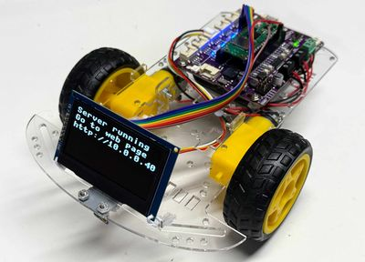

# WiFi Display Bot

{ width="420" }

The WiFi Bot plus an OLED that shows its status as it connects to WiFi and serves a web-page driver control.

**Source book:** STEM Robots  
**Kit page:** [https://dmccreary.github.io/stem-robots/kits/wifi-display-bot/](https://dmccreary.github.io/stem-robots/kits/wifi-display-bot/)  
**Printable one-pager:** [wifi-display-bot-one-pager.html](wifi-display-bot-one-pager.html)

## Features

- Lab: Display Status

## Benefits

- Free, open lessons: the STEM Robots textbook has the kit page, wiring, and MicroPython code.
- Wireless-ready: the Pico W option adds Wi-Fi for time sync and web projects.
- Budget: TBD (adds an OLED, about $4–$13, to the Wireless STEM Robot; the Cytron Robo Pico board was not found on eBay).

## Parts

- **Raspberry Pi Pico W ($5)** — Microcontroller with Wireless (on Cytron Robo Pico)
- **830-Point Breadboard ($1.10)** — Breadboard
- **Micro-USB Data Cable ($2.50)** — Power and programming cable
